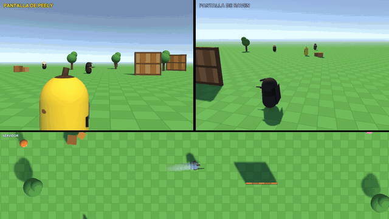

# Por qué te matan detrás de la pared

> La compensación de lag de los shooters online, recreada en Unity: por qué a veces mueres cuando en tu pantalla ya estabas a cubierto.

## Qué muestra este proyecto
En un shooter online no hay una sola partida: hay una por jugador, y todas van con retraso. La demo enseña
las tres versiones del mismo instante en pantalla partida (la de Peely, la de Raven y la del servidor) y
cómo decide el servidor quién acierta:

1. **Ves a los demás en el pasado.** Lo que ves de un enemigo te llega tarde (el ping) y, para que se mueva
   suave, el juego te lo enseña todavía un poco más atrás a propósito (la interpolación).
2. **Sin compensación, fallas aunque apuntes bien**: disparas a una imagen vieja, y cuando tu disparo llega
   al servidor el enemigo ya está en otro sitio.
3. **El servidor rebobina.** Guarda un álbum con dónde estaba cada jugador; tu disparo le dice qué momento
   estabas viendo, y el servidor comprueba el impacto *ahí*. Aciertas.
4. **La consecuencia:** si en tu pantalla el otro aún asomaba, el disparo vale aunque en la suya ya estuviera
   detrás de la pared. Se favorece al que dispara a propósito. Y hay un límite: con un lag enorme, el servidor
   deja de compensar.

No hay red de verdad: clientes y servidor se simulan en la misma escena, con un retraso falso ajustable y un
reloj propio que se puede pausar y poner a cámara lenta. No es el código de Epic: es una recreación de la
técnica habitual de los shooters online. Los personajes son cápsulas, y nada en pantalla es de un juego real.

## Vídeo
_(Enlace al vídeo completo cuando se publique.)_

## Cómo probarlo
1. Clona el repositorio.
2. Ábrelo con **Unity 6000.6.4f1** (Unity 6, plantilla URP).
3. Abre una escena de `Assets/_Project/Scenes` y pulsa Play. Todas tienen todo; solo cambia con qué ajustes empiezan:
   - `00_Arena`: el patio de juegos, con todo a mano.
   - `01_Retraso`: sin interpolación y con los fantasmas visibles: cada versión de Raven va por detrás de la anterior.
   - `02_Interpolacion`: 5 fotos por segundo; pulsa **I** para ver la diferencia entre saltos y movimiento suave.
   - `03_Rebobinado`: dispara con **F** y mira en la pantalla del servidor el rastro (su álbum) y la Raven que usa.
   - `04_Pared`: Peely dispara solo, justo cuando Raven se esconde. La escena del título.
   - `05_ConSinCompensacion`: Peely dispara cada segundo; pulsa **C** para quitar y poner el rebobinado.

| Tecla | Qué hace |
|---|---|
| Espacio | Pausa |
| . (punto) | Avanza un paso (en pausa) |
| 1, 2, 3, 4 | Velocidad ×1, ×0,5, ×0,25, ×0,1 |
| ↑ / ↓ | Más / menos ping |
| I | Interpolación sí / no |
| G | Fantasmas de las otras versiones sí / no (morado = real, blanco = servidor, amarillo = lo que ve Peely) |
| F | Peely dispara a la Raven que ve |
| C | Rebobinado (compensación de lag) sí / no |
| H | Panel de ajustes en pantalla sí / no |

En el inspector del objeto `Simulation` están los sliders: ping, fotos por segundo (*tick rate*), interpolación,
velocidad de Raven, límite de rebobinado y los disparos automáticos. El recorrido de Raven son los hijos de
`RavenRoute`: arrástralos para cambiarlo. En la pantalla del servidor, el panel de ajustes enseña los valores
del momento (ping, fotos por segundo, interpolación, rebobinado, límite y velocidad) y se ilumina el que cambia.

## Estructura
El código sigue una arquitectura por capas, cada una con su asmdef y dependencias solo hacia dentro:

- `Scripts/Domain/` (C# puro, sin Unity): el reloj, el recorrido, el "internet falso" con retraso, el historial
  de posiciones (para interpolar y para rebobinar) y la geometría del disparo (rayo contra cápsula y contra pared).
- `Scripts/Application/`: los clientes (`GameClient`), el servidor (`ServerWorld`, donde está el rebobinado:
  `WhereToCheck`) y los casos de uso (`AdvanceSimulation`, `FireShot`).
- `Scripts/Presentation/`: lo que se ve, solo leyendo: personajes y fantasmas, pantallas partidas, el rastro del
  álbum del servidor, los disparos y el panel de ajustes (`SettingsPanel`).
- `Scripts/Infrastructure/`: Unity. El composition root (`SimulationBootstrap`), el teclado (`DemoInput`, con
  `IInputOverride` para otras herramientas) y las paradas del recorrido.
- `Scripts/Editor/`: `ArenaBuilder` genera el escenario, el fusil y los fantasmas con primitivas
  (**Tools > Lag Compensation**).
- `Scripts/Tests/EditMode/`: tests de Domain y Application. Los de `DeathBehindTheWallTests` recrean la
  escena del título con números.

## Licencia
MIT — consulta [LICENSE](LICENSE).
